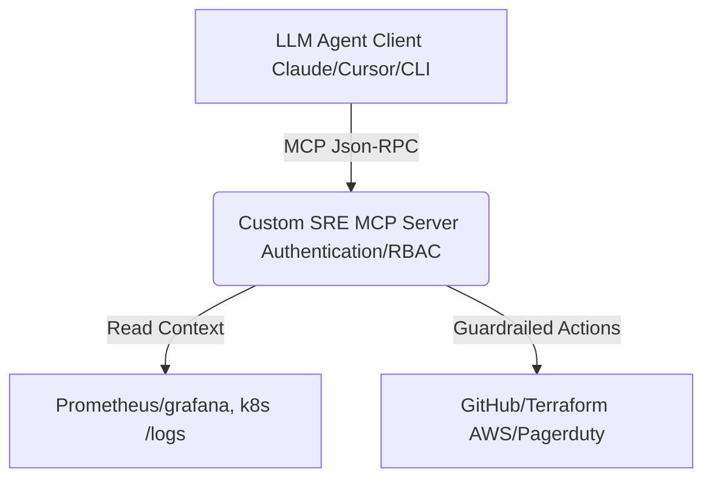

# Incident_triage_MCP
Goal is to build a custom MCP server that exposes high-value operational context and safe, policy-enforced actions to AI Clients

## Implementation Strategy

1. Create environment for infrastructure
    - spin up a lightweight local cluster, either kind, or minikube. 
    - provision grafana/prometheus server to monitor
    - deploy an intentionally buggy python app with a memory leak

2. MCP Server Provisioning
    - use the `mcp` library in python
    - Define Tools, Prompts (pre-baked incident triage workflows), and Resources (e.g., streaming live log files via MCP Resources).

3. Containerization & CI/CD
    - make a multistage docker file for the MCP server
    - Create GH actions workflow to run unit tests, lint MCP schema, and publish the container image

4. Docs and Demo
    - create Thread model and add setup instructions to this readme
    - record a demo showing Claude or Ollama diagnosing an active incident, explaining RC using the MCP server, and executing a dry-run fix.